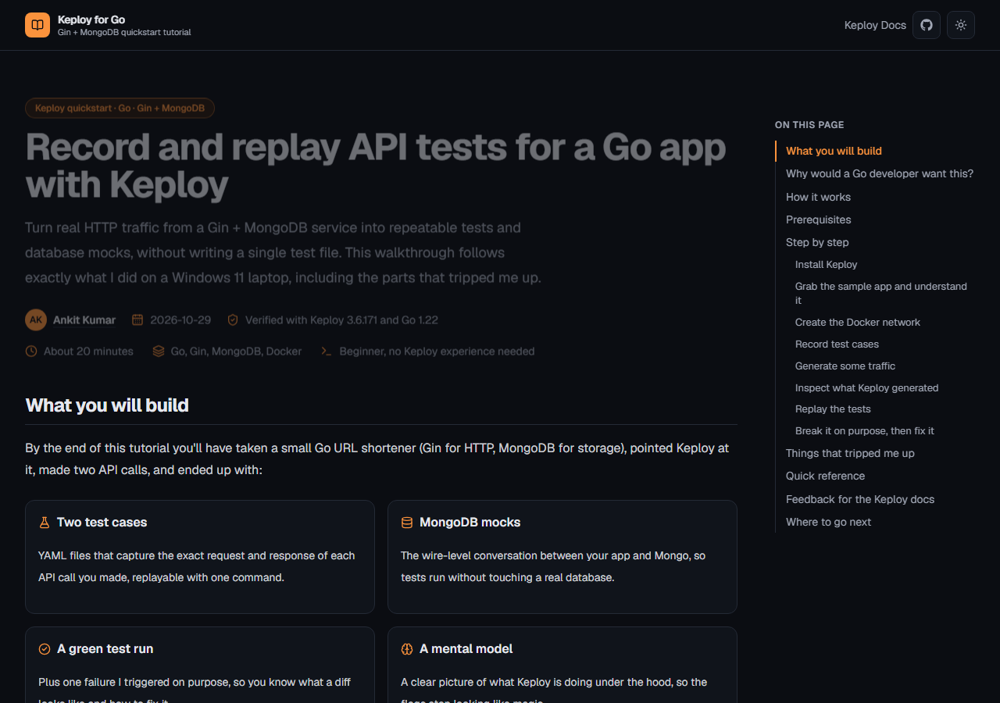

# Record and replay API tests for a Go app with Keploy

**Live:** https://keploy-go-tutorial-ruby.vercel.app

A single-page documentation site, built with Next.js and MDX, that walks a developer who has never
used Keploy through recording and replaying API tests for the `gin-mongo` sample from
[keploy/samples-go](https://github.com/keploy/samples-go). Everything on the page comes from runs I
did myself on a Windows 11 laptop: once through Docker Desktop, once from Ubuntu 22.04 in WSL2.



Written by Ankit Kumar ([@KUMARankit23](https://github.com/KUMARankit23)) for the Keploy DevRel
candidate assignment, October 2026.

## What the page covers

- Why a Go developer would want this, and a diagram of how Keploy sits between the app and MongoDB.
- Eight steps: install, clone, create the Docker network, `keploy record`, generate traffic, read the
  generated YAML, `keploy test`, then break a test on purpose and fix it with noise.
- Things that went wrong on the way: stale Docker Desktop sockets, the external network, a missing
  `--container-name`, and the Keploy 3.8 sign-in requirement that the installer now ships with.
- Feedback for the Keploy docs team, a quick-reference table, and where to go next.

## Evidence

`keploy-run/` holds the actual files Keploy produced during the run described on the page: the two
recorded test cases, `mocks.yaml` with the DNS and MongoDB mocks, the test-mock mappings, both test
reports (the passing run and the deliberately failing one), and the generated `keploy.yml`.

## Tech

| Concern | Choice |
| --- | --- |
| Framework | Next.js 16, App Router, `output: "export"` (plain static files) |
| Content | `src/app/page.mdx` via `@next/mdx`, `remark-gfm`, `rehype-slug` |
| Styling | Tailwind CSS v4 with CSS-variable design tokens |
| Syntax highlighting | `rehype-pretty-code` (Shiki) with paired light and dark themes |
| Dark mode | `next-themes`, header toggle, follows the system by default |
| Icons | `lucide-react` |

Custom MDX components live in `src/components` and are registered in `src/mdx-components.tsx`:
`Callout`, `Steps`/`Step`, `Tabs`/`Tab` (keyboard navigable), `Terminal`, `FileTree`,
`Cards`/`Card`, `RecordReplayDiagram`, `Hero`, a copy button on every code block, and a
scroll-tracking table of contents with a collapsible mobile version.

## Run locally

```bash
npm install
npm run dev
```

Open http://localhost:3000.

```bash
npm run build      # writes the static site to out/
npx serve out      # serve the exported files
```

## Deploy

Deployed to Vercel with `vercel deploy --prod` from this directory. The `out/` folder is a plain
static site, so it can be hosted anywhere.

## License

MIT, see [LICENSE](LICENSE).
